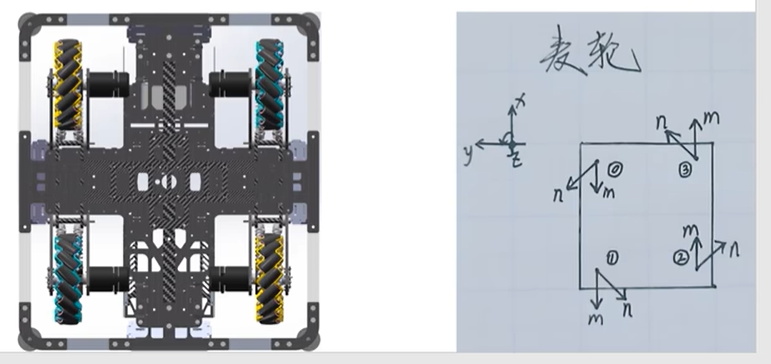
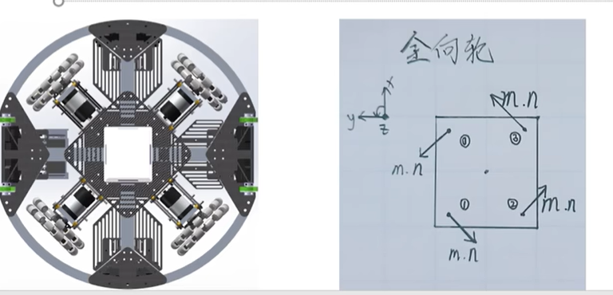

# 底盘解算

麦克纳姆轮、全向轮、舵轮三种全向底盘的解算推导。

三种底盘的解算都是同样的两步：先求每个轮子接地点的速度，再按这个轮子"能出力的方向"把它换成轮速。区别只在第二步——轮子把速度花在了什么地方。

参考资料：[中科大电控合集](https://space.bilibili.com/337732684/lists/1043942)

## 0. 预备知识

### 0.1 坐标系与记号

底盘坐标系取 $x$ 朝前、$y$ 朝左、$z$ 朝上。$v_x,\ v_y$ 是底盘中心的平动速度，$v_w$ 是绕 $z$ 轴的角速度，从上往下看逆时针为正。

| 记号 | 含义 |
| --- | --- |
| $\vec r_i=(x_i,\ y_i)$ | 第 $i$ 个轮子接地点在底盘坐标系下的位置 |
| $\hat d_i$ | 轮子的驱动方向：轮子正转时，底盘被推的方向 |
| $\hat u_i$ | 辊子轴线方向，也就是轮子不能滑动的方向 |
| $\hat s_i$ | 辊子的自由滚动方向，与 $\hat u_i$ 垂直 |
| $R,\ v_i$ | 轮子有效半径、轮子线速度，$v_i=R\omega_i$（$\omega_i$ 是轮子角速度） |

### 0.2 接地点速度合成

底盘是刚体，轮子接地点（属于底盘的那个点）的速度由两部分叠加：

- 平动速度：$\vec v=(v_x,\ v_y)$，底盘上每个点都一样；
- 转动速度：$v_w\hat z\times\vec r_i$，从中心指向轮子接地点，方向与 $\vec r_i$ 垂直。

合成：

$$\vec v_{P_i}=\vec v+v_w\,\hat z\times\vec r_i=(v_x-v_wy_i,\ \ v_y+v_wx_i)$$

三种底盘这一步完全一样，差别在下一步。

### 0.3 轮速的通用求法

轮子和地面不打滑，接地点的速度实际上被两件事分担：

- 轮子自转：轮子以线速度 $v_i$ 正转时，接地点相对底盘沿 $-\hat d_i$ 方向移动 $v_i$；
- 辊子自转：辊子沿自己的自由滚动方向 $\hat s_i$ 旋转，把这个方向上的运动吃掉。

约束落在辊子轴线方向 $\hat u_i$ 上：辊子不会绕自己的轴滚，这个方向一点都不能滑，速度必须全部由轮子自转提供：

$$\vec v_{P_i}\cdot\hat u_i=v_i\left(\hat d_i\cdot\hat u_i\right)
\qquad\Longrightarrow\qquad
v_i=\frac{\vec v_{P_i}\cdot\hat u_i}{\hat d_i\cdot\hat u_i}$$

三种轮子的差别就是 $\hat u_i$ 取得不一样：

| 轮型 | $\hat u_i$ | $\hat d_i\cdot\hat u_i$ | 轮速 |
| --- | --- | --- | --- |
| 普通轮 | $=\hat d_i$（没有辊子，哪个方向都不能滑） | $1$ | $v_i=\vec v_{P_i}\cdot\hat d_i$，且 $\vec v_{P_i}$ 必须与 $\hat d_i$ 同向 |
| 全向轮 | $=\hat d_i$（辊子轴线沿驱动方向） | $1$ | $v_i=\vec v_{P_i}\cdot\hat d_i$ |
| 麦克纳姆轮 | 与 $\hat d_i$ 成 45° | $\pm\frac{1}{\sqrt2}$ | $v_i=\pm\sqrt2\,\vec v_{P_i}\cdot\hat u_i$ |

总结：普通轮只能沿自己的方向走；全向轮是"能横向打滑的普通轮"；麦克纳姆轮的辊子斜了 45°，出力方向也斜了 45°。

后面三种底盘要做的，就是写出各自的 $\hat u_i$，代这个式子。

## 1. 麦克纳姆轮

### 1.1 结构与全向移动原理

左前、右后的辊子轴线指向前右，右前、左后的指向前左。四个 45° 的推力就能配出平面内任意方向的合力。
四个轮子同向转，横向分力两两抵消，剩下向前的力；左边两个反转、右边两个正转，四个力合成一个力偶，底盘自转。

### 1.2 逆解推导

*图 3：左前轮的驱动方向 $\hat d$、辊子轴线 $\hat u$ 与接地点速度 $\vec v_P$。*

以左前轮 FL 为例，它在底盘坐标系里的位置是 $(l_x,\ l_y)$。四个轮子的轮轴都沿 $y$，所以驱动方向 $\hat d=(1,\ 0)$；FL 的辊子轴线朝前右，$\hat u=\frac{1}{\sqrt2}(1,\ -1)$，$\hat d\cdot\hat u=\frac{1}{\sqrt2}$。

接地点速度：

$$\vec v_P=(v_x-v_wl_y,\ \ v_y+v_wl_x)$$

代入通用式：

$$v_{FL}=\frac{(v_x-v_wl_y)\cdot\frac{1}{\sqrt2}+(v_y+v_wl_x)\cdot\left(-\frac{1}{\sqrt2}\right)}{\frac{1}{\sqrt2}}
=v_x-v_y-v_w(l_x+l_y)$$

四个轮子只有 $\hat u_i$ 的符号不同（同一对角线上的两个轮子辊子朝向相同）：

| 轮子 | 位置 | $\hat u_i$ | $v_i$ |
| --- | --- | --- | --- |
| FL | $(l_x,\ l_y)$ | $\frac{1}{\sqrt2}(1,-1)$ | $v_x-v_y-v_w(l_x+l_y)$ |
| FR | $(l_x,-l_y)$ | $\frac{1}{\sqrt2}(1,\ 1)$ | $v_x+v_y+v_w(l_x+l_y)$ |
| RL | $(-l_x,\ l_y)$ | $\frac{1}{\sqrt2}(1,\ 1)$ | $v_x+v_y-v_w(l_x+l_y)$ |
| RR | $(-l_x,-l_y)$ | $\frac{1}{\sqrt2}(1,-1)$ | $v_x-v_y+v_w(l_x+l_y)$ |

## 2. 全向轮

### 2.1 结构与全向移动原理

全向轮也是在轮毂上装一圈辊子，但辊子轴线沿驱动方向，不是斜的。

- 沿驱动方向：辊子轴线方向不能滑动，和普通轮一样能出力；
- 沿轮轴方向：辊子自由滚动，底盘可以横着滑过去。

所以全向轮就是一个"能横向打滑的普通轮"。它出力的方向就是驱动方向，没有麦轮 45° 的投影损失，效率更高，代价是单个轮子仍然不能全向移动——它横向没有力。

多个轮子把驱动方向摆开就能组成全向底盘，常见的有两种：三轮互成 120°，四轮放四角、驱动方向取切向。

驱动方向不能指向底盘中心。指向中心时，自转产生的接地点速度与该轮驱动方向垂直，这个轮子对 $v_w$ 完全没有贡献，三个轮子都这么装，底盘就转不了。

### 2.4 四轮 45° 布置解算

四个轮子放在四角，位置
 $R_c(\cos\theta,\sin\theta)$，$\theta$ 取 $45°,\ 135°,\ 225°,\ 315°$（对应 FL、RL、RR、FR），驱动方向取切向：

| 轮子 | $\theta_i$ | $v_i$ |
| --- | --- | --- |
| FL | $45°$ | $\frac{-v_x+v_y}{\sqrt2}+R_cv_w$ |
| RL | $135°$ | $\frac{-v_x-v_y}{\sqrt2}+R_cv_w$ |
| RR | $225°$ | $\frac{v_x-v_y}{\sqrt2}+R_cv_w$ |
| FR | $315°$ | $\frac{v_x+v_y}{\sqrt2}+R_cv_w$ |

用三个基本运动检查一遍：前进时四个轮速的大小都是 $v_x/\sqrt2$，左侧两个与右侧两个转向相反；左移时前两个与后两个转向相反；自转时四个都是 $+R_cv_w$（都取切向，符号一致，这一点和麦轮不同）。

四个轮子、三个自由度，和麦轮一样过约束，相容条件是

$$v_{FL}+v_{RR}=v_{RL}+v_{FR}$$

## 3. 舵轮

### 3.1 结构与全向移动原理

一个舵轮模块由舵向电机和驱动电机组成，用的是普通轮，没有辊子。轮子只能沿自己的朝向走，所以两个电机必须配合：舵向电机决定往哪个方向走，驱动电机决定走多快。方向由电机自己选，不像麦轮和全向轮那样被辊子的几何定死。

没有辊子，还意味着接地点速度在垂直于驱动方向上的分量也没人管了，必须为零：$\vec v_{P_i}$ 只能整个落在轮子的朝向上，大小就是轮速。所以舵轮的解算从"投影"变成了"求模长和方向角"。

### 3.2 解算推导

!
第一步：速度合成：

$$\vec v_{P_i}=(v_x-v_wy_i,\ \ v_y+v_wx_i)$$

这个速度必须完全由轮子实现，于是轮子的朝向就是 $\vec v_{P_i}$ 的方向，轮速就是它的模长：

$$\theta_i=\operatorname{atan2}\left(v_{P_i,y},\ v_{P_i,x}\right)=\operatorname{atan2}\left(v_y+v_wx_i,\ \ v_x-v_wy_i\right)$$

$$v_i=\left|\vec v_{P_i}\right|=\sqrt{(v_x-v_wy_i)^2+(v_y+v_wx_i)^2}$$

两点注意：$\theta_i$ 要用四象限的 `atan2`，不能用 `atan`，否则 $v_{P_i,x}<0$ 时会差 $180°$；算出来的 $\theta_i$ 是底盘坐标系下的角度，发给舵向电机还要减掉安装零位。

公式的物理意义可以直接读出来：

- 原地自转（$v_x=v_y=0$）时 $\vec v_{P_i}=v_w\hat z\times\vec r_i$，方向与 $\vec r_i$ 垂直，大小是 $|v_w|\cdot|\vec r_i|$，四个模块会一起转到切向，以各自的轮速绕中心转圈；
- 平移（$v_w=0$）时 $\vec v_{P_i}=\vec v$ 与模块位置无关，四个模块转到同一个角度、同一个轮速，也就是蟹行。

### 3.3 三个基本运动的叠加

把三个基本运动下每个模块需要的速度矢量画出来，首尾相接相加，合矢量就是模块最终要出的速度：方向给舵向电机，模长给驱动电机。

1. 前进 $v_x$：每个模块的速度矢量都是 $(v_x,\ 0)$，舵向角 $0°$，轮速 $v_x$，四个模块一样。
2. 左移 $v_y$：每个模块的速度矢量都是 $(0,\ v_y)$，舵向角 $90°$，轮速 $v_y$。
3. 自转 $v_w$：模块 $i$ 的速度矢量是 $v_w\hat z\times\vec r_i=(-v_wy_i,\ v_wx_i)$，方向与 $\vec r_i$ 垂直（切向），大小是 $|v_w|\cdot|\vec r_i|$。

三段矢量加起来正好是 $(v_x-v_wy_i,\ v_y+v_wx_i)$，和 3.2 的公式一致。画图的好处是哪个模块转多少、往哪边转一眼就能看出来。

## 参考

- [中科大电控合集](https://space.bilibili.com/337732684/lists/1043942)（底盘解算、功率控制）
